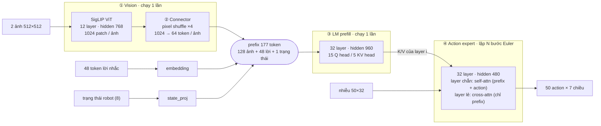

# Bài 6: Chạy và tối ưu SmolVLA trên vla.cpp

## 1. Bài này làm gì

> Model: SmolVLA, bản vrfai/smolvla-libero-gguf
>
> 1. **Cài đặt và chạy thử.** Build vla.cpp có CUDA qua WSL2 theo docs/backend/wsl.md, tự chọn CUDA architecture cho RTX 3060 Laptop và bật build test. Sau đó chạy thử test, CLI, server, Python binding và vla_predict_check để hiểu mỗi công cụ dùng làm gì.
> 2. **Baseline.** Đo latency (p50/p90) và VRAM đỉnh bằng vla-bench theo protocol và cấu hình input cho SmolVLA trong docs/benchmark/ (tham khảo rtx-3060.md). Ghi rõ điều kiện đo vì laptop dễ bị throttle.
> 3. **Tối ưu không cần train.** Thử các runtime flag trong docs/USAGE.md và docs/backend/cuda.md (attention, dtype, số bước denoise, ...). Quantize theo docs/MODELS.md ở nhiều mức, có và không quantize vision tower. Mỗi cấu hình ghi kích thước file, VRAM, latency và độ lệch output so với bản gốc.
> 4. **Đo SR trên LIBERO.** Cài theo mục "End-to-end evaluation (LIBERO client on WSL)" trong docs/backend/wsl.md.
>
>    | Mức | Episode | Dùng cho |
>    |---|---|---|
>    | Smoke test | 1 task × 2 | Mỗi lần đổi GGUF |
>    | Sàng lọc | 10 task × 4 = 40 | Cấu hình flag, quantize, pruning |
>    | Chính thức | 10 task × 20 = 200 | Bản gốc và tối đa 3 cấu hình tốt nhất |
>
> 5. **Profile.** Mô tả hoặc vẽ lại kiến trúc SmolVLA (vision, connector, VLM, action expert, vòng denoise) từ paper và src/models/smolvla.cpp. Đo latency từng thành phần bằng cờ timing theo phase của repo và ghi rõ nó đo gì, giới hạn gì. Với bản gốc và bản tốt nhất, dùng nsys để xem thời gian nằm ở GEMM, attention hay phần khác, GPU có bị trống giữa các kernel không, và ghi lại hạn chế của nsys trên WSL2.
> 6. Bạn tự tìm hiểu các phương pháp pruning phù hợp với SmolVLA, chọn và implement lại một vài phương pháp để đánh giá. Nếu cần định dạng checkpoint safetensors có thể tham khảo HuggingFaceVLA/smolvla_libero. Dùng vla-bench và `nsys` để kiểm tra latency của từng module (vision, VLM, action expert) có giảm thật không.
>
> 1 số Paper tham khảo: [SmolVLA (arXiv 2506.01844)](https://arxiv.org/abs/2506.01844), [CLP: Finetuning VLA Models Requires Fewer Layers Than You Think (arXiv 2606.20246)](https://arxiv.org/abs/2606.20246).

Điều kiện thực hiện:
- Model: `smolvla-libero.gguf` (BF16, 1.1 GB). Checkpoint safetensors cho pruning: `HuggingFaceVLA/smolvla_libero`.
- vla.cpp commit `61f20f1` (2026-11-05), giữ nguyên, không sửa code. Mọi script nằm trong `apps/vla.cpp/scripts/`.
- Máy thật là RTX 3050 Ti Laptop 4 GB, không phải RTX 3060 Laptop. Cùng SM 8.6, nên CUDA architecture vẫn là 86.

| Thành phần | Giá trị |
|---|---|
| Laptop | Ryzen 7 5800H, RAM 15.4 GB |
| GPU | RTX 3050 Ti Laptop 4 GB, SM 8.6 (đề bài ghi RTX 3060 Laptop) |
| Hệ điều hành | Windows + WSL2 2.6.3, Ubuntu 26.04.1, RAM cho WSL 7.5 GiB |
| Toolchain | gcc 15.2, glibc 2.43, CUDA 13.1, cmake 4.2.3, llama.cpp/ggml `b11223` / 0.25.3 |
| Driver | 591.44 (R590) |

## 2. Ý tưởng em hiểu được

Kiến trúc SmolVLA theo cách hiểu của em được minh họa bằng sơ đồ sau:

| Khối | Cấu hình | Tham số | Số lần chạy / predict |
|---|---|--:|---|
| ① Vision SigLIP | 12 layer, hidden 768, FFN 3072, 1024 patch/ảnh | 85M | 1 |
| ② Connector | pixel shuffle ×4, linear 12288 → 960 | 12M | 1 |
| ③ LM | 32 layer, hidden 960, GQA 15Q/5KV, FFN 2560 | 315M | 1 |
| ④ Action expert | 32 layer, hidden 480, FFN 1280 | 97M | N (mặc định 10) |
| Embedding | 49280 × 960 | 47M | – |
| Tổng | | 558M | |

Luồng dữ liệu qua 4 khối:
- **Vision (SigLIP ViT):** mỗi ảnh 512×512 được cắt thành 1024 patch 16×16, đi qua 12 layer transformer. Đây là khối nặng tính toán nhất, vì attention phải tính trên 1024 token mỗi ảnh.
- **Connector:** gộp mỗi nhóm 4×4 patch liền nhau thành một token (pixel shuffle), rồi chiếu sang kích thước 960 của LM. Mỗi ảnh chỉ còn 64 token, nên hai ảnh cho 128 token.
- **LM prefill:** 128 token ảnh, 48 token câu lệnh (đã đệm cho đủ 48) và 1 token trạng thái robot ghép lại thành prefix 177 token, đi qua 32 layer của LM **đúng một lần**. Kết quả không phải là chữ, mà là K/V của từng layer, để action expert đọc lại.
- **Action expert (flow matching):** bắt đầu từ một khối nhiễu 50 × 32, rồi qua N bước Euler (mặc định 10) dần biến nhiễu thành 50 action. Mỗi bước chạy lại toàn bộ 32 layer của expert. Vì vậy expert tuy nhỏ (97M tham số) nhưng chạy nhiều lần, còn LM tuy lớn nhất (315M) nhưng chỉ chạy một lần.

## 3. Cài đặt và chạy thử

1. **Công cụ build (apt):** `build-essential`, `cmake`, `git`, `pkg-config`, `libzmq3-dev`, `libprotobuf-dev`, `protobuf-compiler`; thêm `ccache`. Kết quả: gcc/g++ 15.2.0, cmake 4.2.3, protoc 3.21.12.
2. **CUDA toolkit 13.1** từ repo `wsl-ubuntu` của NVIDIA (chỉ cài `cuda-toolkit-13-1`, không cài driver trong WSL).
   - Chọn 13.1 thay cho 12.6 trong `wsl.md`: driver Windows 591.44 thuộc nhánh R590, và CUDA 13.x hỗ trợ GCC 15 của Ubuntu 26.04.
   - Lỗi khi compile: glibc 2.43 khai báo `rsqrt`/`rsqrtf` với `noexcept`, header CUDA 13.1 thì không. Vá 2 dòng trong `crt/math_functions.h` (có giữ bản `.orig`). Sau khi vá, kernel thử `-arch=sm_86` chạy được.
3. **Clone và build vla.cpp** (commit `61f20f1`):
   - `cmake -B build -DGGML_CUDA=ON -DGGML_CUDA_GRAPHS=ON -DCMAKE_BUILD_TYPE=Release -DCMAKE_CUDA_ARCHITECTURES=86 -DVLA_BUILD_TESTS=ON`.
   - Configure lần đầu 447 s (chủ yếu tải llama.cpp `b11223`). Build `-j4` khoảng 16 phút, 0 lỗi (`-j4` vì WSL chỉ có 7.5 GiB RAM).
   - Có được: `vla-cli`, `vla-server`, `vla-bench`, `tests/vla_predict_check`, thư viện `libvla.so`.
4. **Test (`ctest`):** 13/15 pass.
   - 2 test fail (`foldquant_cuda_op`, `fused_cuda_ops`) đều là so sánh bit-exact (`memcmp`, không dung sai); lệch cỡ 1 ULP. CI của repo chỉ compile các test này trên máy không có GPU, không chạy chúng.
5. **Tải model và chạy `vla-cli`:**
   - `vla-cli -hf` gọi sang CLI `hf`, nên cài `hf` bằng `uv tool install huggingface_hub`.
   - Chạy được bằng token giả (`--tokens`): backend CUDA, fused ops bật, ra action chunk 50 × 32 (7 cột có giá trị).
   - `--text` cần `transformers` để tokenize, nên em tạo một venv nhẹ `~/venvs/vla-tok` (Python 3.12, `transformers`, không có torch).
   - vla-cli **không tất định**: nhiễu ban đầu lấy ngẫu nhiên mỗi lần (`random_device`, `smolvla.cpp:310`), không có cờ seed.
6. **`vla-server`:** ZeroMQ REQ/REP, message protobuf (`src/serving/vla.proto`); request có thể kèm nhiễu.
   - Viết client tối giản không cần torch (vì client chính thức import torch).
   - Cùng câu, cùng nhiễu thì output giống hệt (tất định). Khác câu, cùng nhiễu thì action khác (max |lệch| 2.01).
   - Request đầu tiên khoảng 1 s (khởi tạo); từ request thứ hai, 1 view: total median 111.6 ms.
7. **Python binding:** không `pip install` (sẽ build lại bản chỉ chạy CPU); dùng thư viện CUDA đã build qua `PYTHONPATH` + `VLA_LIBRARY`.
   - Cùng token, cùng nhiễu thì output trùng với vla-server.
   - `TIMING_PHASE` cho tách vision / prefill / denoise, nhưng làm chậm cả lần đo (xem mục 4.4).
8. **`vla_predict_check`** (SmolVLA cần `VLA_IMG_SIZE=512`): tất định (2 lần chạy giống hệt).
   - Bật / tắt fused ops (`VLA_FUSED_OPS=0`): cả 350 giá trị action thật đều khác, max |lệch| 1.06e-3, mean 2.09e-4 (|action| trung bình 0.187). Dùng làm **mức nhiễu nền** khi so các cấu hình.
9. **Cài LIBERO** (`eval/sim/libero/setup_libero.sh` của repo): venv khoảng 10 GB (`torch 2.5.1`, `mujoco 2.3.2`). Render bằng GPU NVIDIA qua d3d12 (`GALLIUM_DRIVER=d3d12 MESA_D3D12_DEFAULT_ADAPTER_NAME=NVIDIA`). Smoke test bản gốc: task 0, 2/2 episode thành công.

## 4. Kết quả

### 4.1. Baseline

Chạy thử baseline trên máy cá nhân (RTX 3050 Ti Laptop 4 GB VRAM), ghi lại kết quả và so sánh với số liệu RTX 3060 desktop trong repo.

Điều kiện đo:
- Cắm sạc, chế độ nguồn của Windows đặt ở Best performance, đã đóng các ứng dụng nặng (Chrome, ...).
- GPU lúc bắt đầu: 49 °C, P0, giới hạn công suất khoảng 84 W.
- Mỗi process chỉ chạy khoảng 3.5 s, nhiệt độ tăng từ khoảng 50 lên 76 °C, nên số baseline phản ánh lúc GPU còn mát.
- 3 process lệch nhau dưới 1 ms (khoảng 0.5%), p90 chỉ hơn p50 khoảng 0.4 ms.

| | Giá trị |
|---|---|
| Protocol | `vla-bench --images 2 --size 512 --warmup 3 --reps 20`, 3 process, BF16, flag mặc định |
| p50 / p90 | **163.9 / 164.3 ms** (vision 91.1 ms) |
| VRAM đỉnh (toàn GPU) | 2039 MiB |
| Host RSS đỉnh | 772 MiB |
| 600 lần liên tục | p50 167.6, p90 170.4 ms; nhiệt 86–88 °C; SM 1900 → khoảng 1730 MHz |

| | RTX 3060 desktop 12 GB (`docs/benchmark/rtx-3060.md`) | RTX 3050 Ti Laptop 4 GB |
|---|--:|--:|
| p50 | 125.3 ms | 163.9 ms (1.31×) |
| vision | 71.6 ms | 91.1 ms |
| VRAM | 2038 MiB | 2039 MiB |

- Hai bên khác nhau cả GPU (desktop 12 GB so với laptop 4 GB), CPU, CUDA (12.8 so với 13.1) và commit vla.cpp (`c93ca0a` so với `61f20f1`), nên tỉ lệ 1.31× chỉ để tham khảo. VRAM gần như bằng nhau vì cùng model và cùng flag.
- Throttle khi chạy lâu (600 lần liên tục, khoảng 105 s):
  - Khoảng 40 s đầu, GPU bị giới hạn bởi công suất (cờ SW power cap, khoảng 80 W). Sau đó nhiệt độ đứng ở khoảng 86 °C, xung SM tụt dần từ khoảng 1900 xuống khoảng 1730 MHz (giảm khoảng 9%), trong khi `nvidia-smi` không báo cờ giới hạn nào.
  - Latency chỉ chậm hơn khoảng 2–4% (p50 167.6, p90 170.4 ms), ít hơn nhiều so với mức tụt xung.
  - Vì vậy khi chạy LIBERO hàng giờ, latency thực tế khoảng 168–170 ms. Khi so các cấu hình tối ưu thì dùng cùng protocol ngắn và nghỉ khoảng 60 s giữa các lượt, để các lượt đo có cùng điều kiện nhiệt.
- Trong WSL không đo được VRAM theo từng process (`nvidia-smi --query-compute-apps` báo `[N/A]`), nên em phải dùng `memory.used` của cả GPU. Cách này chỉ đúng khi không có process nào khác dùng GPU, nên em đã tắt hết app nặng trong suốt quá trình chạy; GPU báo 0 MiB trước khi chạy, nên toàn bộ 2039 MiB thuộc về vla-bench.

### 4.2. Tối ưu không train: flag và quantize

Bước này em thử các tối ưu không cần train, gồm runtime flag và quantize:

- **`--flash-attn`**: cơ chế giống kỹ thuật tiling ở Bài 5. Attention được tính theo từng tile nhỏ nằm gọn trong bộ nhớ trên chip, softmax được cập nhật dần qua từng tile (online softmax), nên không phải ghi cả ma trận attention ra VRAM. Với vision, ma trận này là 1024×1024 cho mỗi head, mỗi ảnh.
  - Trong vla.cpp, flag này chỉ tác động lên vision. Attention của LM và action expert vốn luôn chạy bằng flash-attn (kernel `flash_attn_ext` vẫn chạy dù không bật cờ).
- **`--mm-prec default`**: mặc định của vla.cpp là `--mm-prec f32`, tức lúc nạp model, 416 ma trận trọng số BF16 của LM và expert được nới lên FP32. Chọn giá trị `default` thì giữ nguyên BF16.
- **`--num-steps`**: giảm số bước Euler khi khử nhiễu (mặc định là 10).
- **Quantize** (`scripts/quantize_gguf.py` của vla.cpp): nén trọng số BF16 xuống Q8_0, Q5_0, Q5_1, Q4_0 và Q4_1, có và không có `--vision`.
  - Nguyên lý giống Bài 1, nhưng ggml nén theo **block 32 trọng số, mỗi block một scale riêng**, mịn hơn kiểu per-channel ở Bài 1. Q4_0, Q5_0, Q8_0 là symmetric; Q4_1, Q5_1 có thêm min (affine).
  - Phần được nén là các ma trận của LM, cộng 72 ma trận của vision nếu có `--vision`, còn action expert vẫn giữ BF16.

| Cấu hình (vla-bench, 3 × 20) | p50 ms | vision ms | So với mặc định | VRAM MiB |
|---|--:|--:|--:|--:|
| Mặc định (BF16) | 163.5 | 90.6 | – | 2039 |
| `--flash-attn` | 143.4 | 70.5 | −12.1% | 1971 |
| `--mm-prec default` | 153.3 | 91.0 | −6.2% | 1269 |
| `--flash-attn --mm-prec default` | 132.2 | 70.1 | −19.1% | 1201 |
| `--flash-attn --mm-prec default --num-steps 5` | 111.0 | 70.0 | −32.1% | 1173 |
| Q8_0 + vision, `--flash-attn --mm-prec default` | 118.4 | 58.9 | −27.5% | 835 |
| Q4_0 + vision, `--flash-attn --mm-prec default` | 118.4 | 58.8 | −27.6% | 639 |

Từ bảng trên, em có những nhận xét sau:
- flash-attn chỉ tác động lên vision (91 → 70 ms) còn mm-prec default chỉ tác động lên LM và expert giúp tiết kiệm khoảng 10 ms và 770 MiB.
- Giảm còn 5 bước denoise (`--num-steps 5`) giảm thêm khoảng 21 ms (132.2 → 111.0 ms), nhiều nhất trong các cờ. Nhưng cờ này đổi chính phép tính chứ không chỉ cách tính (output lệch trung bình khoảng 1e-2, so với khoảng 1e-3 của các cờ khác), nên phải kiểm tra bằng SR (mục 4.3).
- Q8_0 và Q4_0 (kèm vision) nhanh như nhau nhưng khác nhau ở dung lượng (0.741 so với 0.535 GB) và VRAM.

Thí nghiệm 2×2×2: thời gian vision (ms), 1 process × 10 lần đo (`scripts/quant_factorial.txt`, `results/quant/factorial/`):

| Trọng số | flash-attn | mm-prec f32 | mm-prec default |
|---|---|--:|--:|
| BF16 | tắt | 91.0 | 91.3 |
| BF16 | bật | 70.5 | 70.5 |
| Q8_0 + vision | tắt | 87.2 | 87.3 |
| Q8_0 + vision | bật | 59.2 | 59.2 |

Kiểm tra thêm khi tắt fused ops (`VLA_FUSED_OPS=0`; `scripts/quant_fused_check.txt`, `results/quant/fused_check/`): thời gian vision (ms), mm-prec f32:

| | fa tắt, fused bật | fa tắt, fused tắt | fa bật, fused bật | fa bật, fused tắt |
|---|--:|--:|--:|--:|
| BF16 | 91.0 | 110.6 | 70.5 | 70.9 |
| Q8_0 + vision | 87.2 | 99.3 | 59.2 | 59.2 |
| Lợi ích của Q8 | −3.8 | −11.3 | −11.3 | −11.7 |

- Ban đầu em kết luận "quantize vision chỉ có lợi khi bật flash-attn, vì attention là nút thắt". Kết luận này dựa trên việc so "Q8_0 + vision, flag mặc định" (vision 87 ms, so với 91 ms của BF16) với "Q8_0 + vision, `--flash-attn --mm-prec default`" (59 ms, so với 70.5 ms). Nhưng hai phép đo này khác nhau ở cả flash-attn lẫn mm-prec, nên không biết được lợi ích đến từ đâu. Vì vậy em làm thêm thí nghiệm 2×2×2.
- Đo đủ 2×2×2 thì em thấy mm-prec không làm vision thay đổi. Tắt fused ops thì lợi ích của Q8 luôn khoảng 11 ms, dù bật hay tắt flash-attn. Như vậy giả thuyết "attention là nút thắt" là sai.
- Cách giải thích phù hợp với số liệu: một số kernel gộp của vla.cpp (ví dụ LayerNorm gộp với GEMM) chỉ dùng được khi trọng số là BF16. Bản Q8 mất phần gộp này, nên khi flash-attn tắt, lợi ích khoảng 11 ms của kernel int8 bị trừ bớt, chỉ còn khoảng 4 ms. Phần profile (mục 4.4) xác nhận điều này: Q8 ở vision tốn thêm khoảng 19 ms cho các kernel phụ chạy rời.
- Bài học em rút ra: khi hai cấu hình khác nhau nhiều hơn một biến, phải đo đủ tổ hợp rồi mới kết luận nguyên nhân.

### 4.3. SR trên LIBERO

Bước này em tiến hành đo success rate (SR) trên LIBERO, gồm 2 vòng: vòng sàng lọc để tìm ra 3 cấu hình tốt nhất, và vòng chính thức để tìm ra cấu hình tốt nhất trong 3 cấu hình này.

Cách đo:
- `libero_object` (10 task gắp vật bỏ vào giỏ), client của vla.cpp qua `scripts/run_libero_sr.sh`. Mỗi bước gọi model một lần (`n_action_steps = 1`), tối đa 500 bước mỗi episode.
- Seed 42: episode thứ k của mọi cấu hình có cùng trạng thái ban đầu, nên so được từng cặp (McNemar).
- Sàng lọc 10 × 4 = 40 episode; chính thức 10 × 20 = 200 episode. SR kèm khoảng tin cậy Wilson 95%.
- Tên cấu hình: `q8v` / `q4v` = Q8_0 / Q4_0 cả vision; `fa` = `--flash-attn`; `mmdef` = `--mm-prec default`; `s5` = `--num-steps 5`.

Sàng lọc (10 task × 4 episode):

| Cấu hình | SR | 95% CI | Server total ms |
|---|--:|---|--:|
| bf16 | 35/40 | 74–95% | 168.5 |
| bf16_fa_mmdef | 32/40 | 65–90% | 137.2 |
| bf16_fa_mmdef_s5 | 35/40 | 74–95% | 113.3 |
| q8v_fa_mmdef | 35/40 | 74–95% | 121.8 |
| q4v_fa_mmdef | **16/40** | 26–55% | 123.2 |
| q8v_fa_mmdef_s5 | 37/40 | 80–97% | 99.5 |

Nhận xét của em sau vòng sàng lọc:
- **Cấu hình bị loại: `q4v_fa_mmdef`** (16/40). Khoảng tin cậy 26–55% không chồng với bản gốc (74–95%), và task nào cũng kém. Các cấu hình còn lại có khoảng tin cậy chồng nhau, nên với 40 episode chưa phân biệt được.
- **`bf16_fa_mmdef`** (32/40) kém bản gốc 3 episode, nằm trong mức nhiễu (output của nó chỉ lệch khoảng 1.7e-3). Dù vậy không chọn, vì bản 5 bước (`bf16_fa_mmdef_s5`) cũng giữ SR mà nhanh hơn.
- **3 cấu hình em chọn vào vòng chính thức** (cộng bản gốc `bf16` để làm mốc), đều giữ SR ngang hoặc hơn bản gốc:
  - `q8v_fa_mmdef_s5`: 37/40, nhanh nhất (99.5 ms, −41%);
  - `bf16_fa_mmdef_s5`: 35/40, 113.3 ms (−33%), giữ nguyên trọng số BF16;
  - `q8v_fa_mmdef`: 35/40, 121.8 ms (−28%), giữ đủ 10 bước denoise.

Vòng chính thức (10 task × 20 episode, cùng seed):

| Cấu hình | SR | 95% CI | McNemar p (so với bf16) | Server total / vision / inf ms | VRAM |
|---|--:|---|--:|---|--:|
| bf16 | 87.5% (175/200) | 82–91% | – | 170.7 / 93.6 / 76.3 | 2457 MiB |
| bf16_fa_mmdef_s5 | 88.0% (176/200) | 83–92% | 1.00 | 115.2 / 72.1 / 42.3 | 1591 MiB |
| q8v_fa_mmdef | 85.0% (170/200) | 79–89% | 0.54 | 123.7 / 60.6 / 62.3 | 1253 MiB |
| q8v_fa_mmdef_s5 | 86.0% (172/200) | 81–90% | 0.76 | 101.0 / 60.6 / 39.4 | 1227 MiB |

Nhận xét của em sau vòng chính thức:
- Cả 3 cấu hình tối ưu đều không làm giảm SR thấy được (McNemar p ≥ 0.54 so với bản gốc); khoảng tin cậy ±5 điểm ở 200 episode.
- Task 5 khó nhất cho mọi cấu hình (9–13/20) và cũng mất thời gian lâu nhất ở cả 4 cấu hình, vì nhiều episode thất bại phải chạy hết 500 bước.
- Vòng sàng lọc chỉ loại được cấu hình hỏng hẳn (Q4) dựa vào việc cấu hình đó có SR thấp hơn hẳn; không xếp hạng được các cấu hình chênh vài điểm vì có thể chênh lệch này là nhiễu (q8v_s5 37/40 ở sàng lọc nhưng 86% ở official).
- **Cấu hình tốt nhất đề xuất sau vòng này: `q8v_fa_mmdef_s5`**: 101.0 ms (nhanh hơn bf16 41%), SR 86.0%, VRAM giảm một nửa. Mục 4.6 cải thiện thêm bằng cách giảm xuống 4 bước.

### 4.4. Profile

Bước này em tiến hành vẽ sơ đồ kiến trúc của SmolVLA, đồng thời đo latency từng thành phần trong kiến trúc. Sơ đồ kiến trúc đã được vẽ ở mục 2, phần sau đây chỉ để ghi lại kết quả đo latency từng thành phần.

Cách đo:
- Em đo bằng hai công cụ. Thứ nhất là cờ đo thời gian theo từng phần có sẵn trong repo (`vla-server --timing-detail phase`); server trả thời gian từng phần trong mỗi response, em đọc bằng script `phase_client.py`. Thứ hai là nsys, một công cụ ghi lại từng kernel chạy trên GPU, dùng khi chạy `vla-bench`.
- Em đo ba cấu hình:
  - bản gốc `bf16`;
  - bản tốt nhất ở thời điểm đó, `q8v_fa_mmdef_s5`;
  - `bf16_mmdef`, là bản gốc chỉ bật thêm `--mm-prec default`, để xem riêng tác dụng của cờ này.
- **Cờ đo theo phần chia thời gian thành:**
  - vision: tower SigLIP và connector;
  - inference: phần còn lại trên GPU, gồm LM prefill và các bước khử nhiễu của action expert (denoise);
  - other: việc CPU làm ngoài hai phần trên, như chuẩn hóa input, dựng mask attention, chép dữ liệu lên và xuống GPU.
- **Giới hạn của cờ này:** khi bật cờ, chính việc đo làm chương trình chạy chậm đi. Để tách được prefill và denoise, mỗi lần gọi model phải dựng lại đồ thị tính toán và chép K/V giữa hai đồ thị (prefill và denoise). Lúc chạy bình thường, cả hai phần nằm chung một đồ thị đã dựng sẵn và chạy liền một mạch. So sánh khi tắt và bật cờ:

  | ms (median) | bf16, tắt cờ | bf16, bật cờ | q8v_s5, tắt cờ | q8v_s5, bật cờ |
  |---|--:|--:|--:|--:|
  | Tổng thời gian | 164.8 | 252.9 | 98.2 | 157.3 |
  | Other (việc của CPU) | 0.8 | 41.4 | 0.8 | 29.0 |
  | Prefill | không tách được | 24.1 | không tách được | 17.2 |
  | Denoise | không tách được | 80.2 | không tách được | 49.3 |

  - Bật cờ làm tổng thời gian tăng 54–60%.
  - Tỉ lệ giữa các phần cũng sai. Ví dụ theo cờ này, mỗi bước denoise của q8v_s5 mất 9.9 ms, còn của bf16 chỉ 8.0 ms, ngược với các phép đo khác.
  - Vì vậy em chỉ dùng cờ này để biết model gồm những phần nào. Thời gian thật của từng phần thì lấy từ nsys.
- **Cách dùng nsys:** chạy `nsys profile --trace=cuda,osrt --cuda-graph-trace=node`. Tùy chọn cuối giúp nsys ghi được cả các kernel nằm trong CUDA graph. Việc đo chỉ làm chương trình chậm đi khoảng 2%.
  - vla.cpp không đánh dấu ranh giới giữa các phần trong timeline (không có NVTX marker), nên em tự chia dựa vào các mốc dễ nhận ra: lúc chép ảnh lên GPU, lúc kéo action về, và kernel attention đầu tiên của mỗi bước denoise.
  - Bỏ 3 lần predict đầu (lần đầu chậm vì nạp thư viện và dựng CUDA graph), rồi lấy trung vị của 20 lần.
- **Hạn chế của nsys trên WSL2:**
  - Không đọc được bộ đếm hiệu năng của GPU: cả GPU metrics của nsys lẫn ncu đều báo lỗi `ERR_NVGPUCTRPERM`, vì driver không cho người dùng thường đọc các bộ đếm này.
  - Không lấy mẫu CPU được cho toàn hệ thống.
  - Vì vậy em không có số đo phần cứng như băng thông bộ nhớ thực hay mức độ các SM được dùng. Các kết luận bên dưới dựa trên thời gian của từng kernel, cộng với số byte và số phép tính em tự tính trên giấy.

| ms (nsys, median 20 predict) | bf16 | bf16_mmdef | q8v_fa_mmdef_s5 |
|---|--:|--:|--:|
| Vision (SigLIP + connector) | 90.7 (55%) | 90.6 | 58.5 (60%) |
| LM prefill | 15.5 | 13.1 | 11.4 |
| Denoise (action expert) | 59.5 (10 bước × 5.95) | 51.4 (10 bước × 5.14) | 28.0 (5 bước × 5.6) |
| **Tổng** | **165.9** | **155.3** | **98.2** |

Dựa trên số liệu, em trả lời các câu hỏi trong đề bài:

**Thời gian đi đâu**
- Vision là phần tốn nhiều thời gian nhất: khoảng 91 ms (55%) ở bản gốc và 58.5 ms (60%) ở q8v_s5. Đây cũng là phần duy nhất nặng tính toán: mỗi ảnh có 1024 patch, và attention phải tính trên ma trận 1024×1024.
- Denoise đứng thứ hai (59.5 ms, 36% ở bản gốc). Action expert nhỏ (97M tham số), nhưng phải chạy lại 10 lần cho mỗi predict.
- LM prefill chỉ khoảng 15 ms (9%), dù LM có nhiều tham số nhất (315M), vì chỉ chạy một lần. Prefill chỉ có 31 lần tính attention thay vì 32: output của layer LM cuối không được dùng tới (expert chỉ cần K/V của nó), nên ggml tự bỏ phần còn lại của layer đó.

**Thời gian nằm ở GEMM, attention hay phần khác**
- Ở bản gốc, GEMM chiếm khoảng 60% thời gian GPU. Khi không bật flash-attn, riêng kernel softmax trong attention của vision đã chiếm 18.9% thời gian GPU, khoảng 34 ms mỗi predict. Phần còn lại là các phép theo từng phần tử, norm, chép và đổi kiểu dữ liệu.
- Thời gian vision theo loại kernel, bản gốc so với Q8 + flash-attn (ms mỗi predict):

  | Loại kernel | bf16 | q8v_fa | Chênh |
  |---|--:|--:|--:|
  | Attention | 33.6 | 8.3 | −25.3 |
  | GEMM | 43.1 | 18.0 | −25.1 |
  | Phép theo từng phần tử | 9.2 | 16.7 | +7.5 |
  | Chép, đổi kiểu | 0.5 | 6.4 | +5.9 |
  | Lượng tử hóa activation | 0 | 5.2 | +5.2 |
  | Norm | 1.5 | 2.1 | +0.6 |

- Q8 cùng flash-attn cắt được khoảng 25 ms ở attention và 25 ms ở GEMM, nhưng tốn thêm khoảng 19 ms cho các kernel phụ, vì hai lý do:
  - các kernel gộp của vla.cpp (bias + GELU, LayerNorm) chỉ dùng được với trọng số BF16, nên với Q8 các phép này phải chạy rời từng kernel;
  - activation phải được lượng tử hóa trước mỗi phép nhân.

**GPU có bị trống giữa các kernel không**
- Gần như không. Khoảng 7500 kernel mỗi predict chạy sát nhau; tổng thời gian GPU trống chỉ khoảng 3.7 ms (5%) trong phần inference và 1.5 ms trong vision.

**Tác dụng riêng của `--mm-prec default`** (so `bf16` với `bf16_mmdef`, hai cấu hình chỉ khác đúng cờ này)
- Tổng thời gian giảm 10.6 ms (165.9 → 155.3 ms): denoise giảm 8.1 ms, prefill giảm 2.4 ms, vision không đổi. Khoảng 3/4 lợi ích nằm ở action expert.
- Mỗi bước denoise chỉ nhanh hơn 14% (5.95 → 5.14 ms), dù số byte trọng số phải đọc giảm một nửa. Mỗi bước có khoảng 700 kernel nhỏ, mỗi phép nhân ma trận chỉ có 50 hàng (50 action token), nên action expert bị giới hạn chủ yếu bởi số lượng kernel chứ không phải băng thông bộ nhớ.

### 4.5. Pruning

Bước này em sẽ thử các phương pháp pruning với SmolVLA.

**Chọn phương pháp nào và vì sao**
- Em bắt đầu với CLP, paper mentor gợi ý. Đây là depth pruning, tức bỏ bớt cả layer. Mỗi layer được chấm điểm bằng CKA giữa input và output của nó: CKA càng cao thì layer càng ít làm thay đổi biểu diễn, nên càng "thừa".
- Lý do chọn depth: theo profile (mục 4.4), action expert bị giới hạn bởi số kernel, nên phải bỏ cả layer (bớt kernel) thì mới giảm được thời gian thật.
- CLP gốc fine-tune 100k bước sau khi cắt. Theo hướng dẫn của mentor, em chỉ làm tới bước trước khi train rồi đánh giá. Để có cơ sở so sánh, em thử 4 cách chọn layer:
  - CKA (cách của CLP);
  - cosine giữa input và output của layer (giống ShortGPT);
  - bỏ các layer cuối;
  - chọn ngẫu nhiên.
- Sau đó, vì VRAM hạn chế nên mentor yêu cầu không train lại mà khảo sát rộng các phương pháp không cần train. Em thử thêm width pruning (bỏ bớt neuron trong FFN) và bù trọng số sau khi cắt.

**Ràng buộc của vla.cpp**
- Layer i của action expert đọc K/V do layer i của LM tạo ra, nên phải bỏ theo cặp: LM layer i đi cùng expert layer i.
- vla.cpp suy kiểu của mỗi layer expert (self-attention hay cross-attention) từ chỉ số layer: chỉ số chẵn là self-attention, lẻ là cross-attention. Bỏ một layer lẻ loi sẽ làm các layer phía sau bị đổi kiểu, nên chỉ bỏ được từng cặp chỉ số liền nhau (i và i+1), hoặc các layer cuối.
- Kích thước của ViT được ghi cứng trong code (`smolvla.cpp:262-263`), nên không cắt được ViT. Kích thước FFN của LM cũng bị ghi cứng (2560) trong converter, nên width pruning chỉ làm được ở action expert.
- Vì vậy mọi thí nghiệm chỉ cắt LM và action expert.

**Kiểm tra pipeline có đúng không**
- Vòng SR đầu tiên (bỏ 8 layer) ra gần 0%, nên trước khi kết luận em kiểm tra lại pipeline cắt, convert sang GGUF rồi nạp vào vla.cpp. Cùng một bản cắt chạy trên vla.cpp và trên PyTorch chỉ lệch nhau 2.2e-4, ngang mức lệch của bản không cắt. Như vậy pipeline đúng, SR thấp là do chính model.

**Thước đo offline `rel`**
- Mỗi lượt SR sàng lọc tốn khoảng 25–75 phút (cấu hình càng hỏng thì càng lâu, vì episode thất bại chạy hết 500 bước), nên em cần một cách sàng lọc rẻ hơn. Độ lệch đo trên một input tổng hợp như ở mục 4.2 không dùng được: Q4 + vision lệch ít trên input đó nhưng SR sập còn 16/40 (mục 4.3).
- Em ghi lại 279 request thật khi chạy LIBERO bằng bản gốc (ảnh, câu lệnh, trạng thái robot và nhiễu), rồi cho từng cấu hình chạy lại đúng các request đó.
- `rel` là độ lệch trung bình của lệnh tay máy (6 chiều) ở action đầu tiên so với bản gốc, chia cho độ lớn trung bình của lệnh tay máy (0.132), tính trên 100 mẫu. Ví dụ rel = 0.1 nghĩa là lệnh lệch khoảng 10%.
- Script đo có một bug: `torch.from_numpy(x).float()` không tạo bản sao khi `x` đã là float32, nên bước chuẩn hóa trạng thái robot sửa thẳng vào mẫu đã nạp sẵn, và mỗi cấu hình chạy sau bị chuẩn hóa thêm một lần nữa. Dấu hiệu là kết quả thay đổi theo thứ tự chạy, và PyTorch không khớp vla.cpp. Lúc đầu em tưởng thư viện lerobot cắt layer sai. Sửa bằng `.clone()`.

**Depth pruning khi không bù: model hỏng**
- Bỏ 8 layer (25%): SR chỉ còn 0–5% với cả 3 cách chọn layer, dù inference nhanh hơn khoảng 16 ms (bảng SR bên dưới).
- rel tăng đều theo số layer bị bỏ, với mọi cách chọn. CKA không chọn layer tốt hơn ngẫu nhiên; cosine tốt nhất; bỏ các layer cuối là tệ nhất.
- Liên hệ Bài 3: ở Bài 3, structured pruning 50% ngay sau khi cắt chỉ còn 9.74% accuracy và phải fine-tune mới hồi lại; trước fine-tune, chọn ngẫu nhiên cũng ngang tiêu chí L1. SmolVLA lặp lại đúng phần "trước fine-tune" đó. Vì vậy kết luận "CKA không hơn ngẫu nhiên" chỉ đúng khi chưa fine-tune.

Depth pruning (bỏ cặp LM i và expert i), rel khi không bù và khi có bù trọng số:

| Bỏ | cka (CLP) | cos | last | rand |
|---|---|---|---|---|
| k1 (2 layer) | 0.161 / 0.052 | 0.161 / 0.052 | 0.214 / 0.062 | 0.159 / 0.064 |
| k2 (4 layer) | 0.320 / 0.098 | 0.243 / **0.087** | 0.375 / 0.114 | 0.215 / 0.089 |
| k3 (6 layer) | 0.416 / 0.130 | 0.316 / 0.115 | 0.506 / 0.150 | 0.367 / 0.147 |
| k4 (8 layer) | 0.447 / 0.168 | 0.364 / 0.142 | 0.582 / 0.185 | 0.456 / 0.167 |

**Width pruning**

Bỏ một tỉ lệ neuron trong FFN của mọi layer. Neuron được chọn theo ba cách: theo activation trên dữ liệu thật (act), theo độ lớn trọng số (mag), hoặc ngẫu nhiên (rand). Giá trị trong bảng là rel:

| Bỏ neuron FFN | LM, theo act | Expert, theo act | Expert, theo mag | Expert, ngẫu nhiên | Expert, theo act, có bù |
|---|--:|--:|--:|--:|--:|
| 5% | 0.143 | 0.016 | 0.051 | 0.049 | – |
| 25% | 0.415 | 0.077 | 0.196 | 0.204 | 0.033 |
| 50% | 0.457 | 0.187 | 0.394 | 0.409 | 0.067 |

- LM: bỏ chỉ 5% neuron đã lệch ngang bỏ 2 layer. Một số layer đầu của LM rất mong manh (layer 3 có một neuron có điểm activation gấp khoảng 330 lần trung vị), trong khi vla.cpp bắt mọi layer phải bỏ cùng số neuron.
- Action expert: chọn theo activation thì bỏ 25% neuron chỉ lệch 0.077. Nhưng nó chỉ nhanh hơn khoảng 3 ms ở bf16, và không đo được lợi ích nào ở q8v_s5: expert bị giới hạn bởi số kernel (mục 4.4), mà thu nhỏ ma trận thì không bớt kernel nào.
- Lần thử đầu trên 10 mẫu cho đường cong không đều: bỏ 25% neuron của LM lệch nhiều hơn bỏ 50%. Trên 100 mẫu thì đường cong đều lại. Nguyên nhân là các layer đầu của LM quá mong manh: model đã hỏng thì action ra lung tung, và với ít mẫu thì độ lệch không còn tăng đều.

**Bù trọng số**
- Ý tưởng: sau khi cắt, chỉnh lại giá trị của một vài ma trận `down_proj` còn giữ, để phần còn lại của model bắt chước được output của model gốc. Với depth, layer đứng ngay trước đoạn bị bỏ học thêm một ma trận M, để tự tạo lại phần thay đổi mà đoạn bị bỏ từng cộng vào. M được giải bằng bình phương tối thiểu (hồi quy ridge) trên dữ liệu calibration.
- Khác với fine-tune:
  - không có gradient và không cần nhãn, vì "thầy" chính là model gốc;
  - mỗi chỗ cắt chỉ sửa một ma trận, chạy trong vài phút và vừa với 4 GB VRAM;
  - kích thước ma trận giữ nguyên, nên bản đã bù vẫn chạy trên vla.cpp gốc;
  - đổi lại, nó yếu hơn fine-tune: chỉ thêm được một hàm tuyến tính, và không bao giờ tốt hơn model gốc.
- Kết quả:
  - rel giảm khoảng 3 lần ở mọi cấu hình (bảng depth ở trên);
  - cùng 8 layer bị bỏ (cka_k4), SR tăng từ 2/40 lên 28/40;
  - bỏ 4 layer (cos_k2_comp) giữ nguyên SR 35/40, inference nhanh hơn 7 ms.
- Lần thử đầu trên 10 mẫu, em so số của bản có bù (10 mẫu) với số của bản không bù lấy từ lần đo 100 mẫu, mà hai tập mẫu có thang khác nhau. Phải thêm tùy chọn đo luôn bản không bù trên cùng tập mẫu thì mới so được.

SR và latency (BF16, flag mặc định; sàng lọc 40 episode):

| Cấu hình | rel | SR | Server total / inf ms | Inference so với gốc |
|---|--:|--:|---|--:|
| bf16 gốc | 0 | 35/40 | 168.5 / 74.7 | – |
| cka_k4 (không bù) | 0.447 | 2/40 | 153.0 / 58.3 | −16.4 ms |
| last_k4 (không bù) | 0.582 | 0/40 | 154.2 / 58.9 | −15.8 ms |
| rand_k4 (không bù) | 0.456 | 0/40 | 153.7 / 58.7 | −16.0 ms |
| **cos_k2_comp** | 0.087 | **35/40** | 162.5 / 67.5 | −7.2 ms |
| cos_k4_comp | 0.142 | 30/40 | 153.4 / 58.5 | −16.2 ms |
| cka_k4_comp | 0.168 | 28/40 | 152.6 / 57.9 | −16.8 ms |

Latency đo bằng vla-bench (p50, mỗi cấu hình 1 process × 20 lần):

| Cấu hình | Tổng | Vision | So với mốc của nhóm |
|---|--:|--:|--:|
| bf16 gốc (mốc) | 165.1 ms | 91.4 ms | – |
| cos_k2_comp | 155.9 ms | 91.4 ms | −5.6% |
| cos_k4_comp | 146.4 ms | 91.2 ms | −11.3% |
| Width expert 25%, không bù (lần đo khác, mốc 166.6 ms) | 163.8 ms | 92.7 ms | −1.7% |
| q8v_s5 (mốc) | 99.8 ms | 61.1 ms | – |
| q8v_s5 + cos_k2_comp | 93.2 ms | 59.4 ms | −6.6% |
| q8v_s5 + cos_k4_comp | 87.9 ms | 58.9 ms | −11.9% |

Từ kết quả đo này, em có một số kết luận như sau:
- Nếu không fine-tune và không bù trọng số, chỉ cần bỏ 8 layer (25%) là SR còn 0–5%, với cả 3 cách chọn layer đã chạy SR (CKA, bỏ layer cuối, ngẫu nhiên).
- Có bù trọng số thì cắt ít vẫn dùng được: bỏ 4 layer (cos_k2_comp) giữ nguyên SR 35/40, tổng latency nhanh hơn 6–9 ms (khoảng 3.5–5.5%, tùy lần đo). Nhưng cắt nhiều hơn thì SR giảm theo: bỏ 8 layer có bù (cos_k4_comp, cka_k4_comp) nhanh hơn khoảng 9–11% nhưng SR chỉ còn 70–75%, một sự đánh đổi không đáng.
- Ghép vào cấu hình đề xuất q8v_s5, bản cắt có bù chỉ nhanh thêm 6.6% (bỏ 4 layer) và 11.9% (bỏ 8 layer), trong khi độ lệch tăng lên mức dự đoán sẽ mất khoảng 5–15 điểm SR. Vì vậy pruning không cộng thêm giá trị lên q8v_s5, và em không chạy SR cho các bản ghép này.
- Theo số đo ở mục 4.4, vision là phần đáng tối ưu nhất vì chiếm 55–60% thời gian, nhưng kích thước của nó bị ghi cứng trong vla.cpp, nên không cắt được nếu không sửa code vla.cpp.

Khảo sát các phương pháp pruning không cần train (theo yêu cầu của mentor):
- Em xem 17 phương pháp. Chỉ nhóm bỏ cả layer (như CLP, ShortGPT) chạy được trên vla.cpp gốc mà vẫn giảm latency thật.
- FLAP, SliceGPT, BlockPruner, bỏ bớt token ảnh, hay cache kết quả của action head giữa các bước denoise đều cần sửa vla.cpp.
- Wanda và SparseGPT (đặt từng trọng số về 0) không làm nhanh hơn, vì ggml không có kernel nhân ma trận thưa.

### 4.6. Giảm số bước denoise

Sau phần pruning, em muốn biết trên nền cấu hình đề xuất q8v_s5, nếu muốn nhanh thêm vài ms thì cách nào mất ít độ chính xác nhất. Ngoài việc ghép thêm pruning, còn một cách đơn giản hơn: giảm tiếp số bước denoise.

**Vì sao xếp cạnh pruning**
- Giảm số bước denoise không thay đổi model: vẫn đủ 32 layer, đủ trọng số. Nó chỉ cho action expert chạy ít lần hơn trong mỗi lần predict. Có thể xem đây là "cắt theo thời gian", trong khi pruning là cắt bớt model.
- Flow matching sinh action bằng cách đi từ nhiễu tới action qua N bước Euler. Đi ít bước hơn thì mỗi bước dài hơn và đường đi kém chính xác hơn. Đây là nguồn gốc của độ lệch.
- Ưu điểm lớn so với pruning: chỉ là một cờ (`--num-steps`), không cần file model mới, không cần dữ liệu calibration, nên gần như không có chi phí duy trì.
- Trước đó em mới kiểm tra 5 bước bằng SR (mục 4.3). Ở bước thử flag, các mức 3, 2 và 1 bước chỉ được đo trên một input tổng hợp, còn 4 bước thì chưa đo lần nào.

**Độ lệch và latency** (q8v_fa_mmdef, rel trên 100 mẫu như mục 4.5, latency bằng vla-bench):

| Số bước | rel | Tổng latency (p50) | So với 5 bước |
|---|--:|--:|--:|
| 5 | 0.067 | 98.5 ms | – |
| 4 | 0.096 | 93.2 ms | −5.4% |
| 3 | 0.145 | 88.7 ms | −9.9% |
| 2 | 0.238 | 84.3 ms | −14.4% |

- Mỗi bước tốn khoảng 4.7 ms. Vision giữ nguyên khoảng 59 ms.
- Độ lệch tăng nhanh khi giảm bước: 3 bước đã lệch ngang bỏ 8 layer có bù (cos_k4_comp, 0.142), 2 bước gần bằng Q4 + vision (0.258).

**So sánh các cách nhanh thêm trên q8v_s5:** mỗi ms nhanh hơn phải trả bao nhiêu độ lệch.

| Cách | Nhanh thêm | rel tăng thêm cho mỗi ms |
|---|--:|--:|
| Giảm còn 4 bước | 5.3 ms | 0.0055 |
| Ghép cos_k2_comp (bỏ 4 layer, có bù) | 6.6 ms | 0.0073 |
| Ghép cos_k4_comp (bỏ 8 layer, có bù) | 11.9 ms | 0.0078 |
| Giảm còn 3 bước | 9.8 ms | 0.0080 |
| Giảm còn 2 bước | 14.2 ms | 0.0120 |

- Giảm còn 4 bước là cách "rẻ" nhất: mỗi ms tốn ít độ lệch nhất.
- Các cách còn lại đều có cái giá gần nhau, khoảng 0.007–0.008 cho mỗi ms, trừ giảm còn 2 bước (0.012, đắt hơn hẳn). Không có cách nào nhanh thêm mà miễn phí. Điều này cho thấy q8v_s5 đã nằm gần điểm mà từ đó trở đi, mỗi phần trăm tốc độ đều phải trả bằng độ chính xác.

**SR của 4 bước** (cùng cách đo như mục 4.3; `s4` = `--num-steps 4`):

| Cấu hình | Sàng lọc (40 episode) | Chính thức (200 episode) | 95% CI | McNemar p so với 5 bước | McNemar p so với bản gốc | Tổng latency (server) | VRAM |
|---|--:|--:|---|--:|--:|--:|--:|
| q8v_fa_mmdef_s5 | 37/40 | 86.0% (172/200) | 81–90% | – | 0.76 | 101.0 ms | 1227 MiB |
| **q8v_fa_mmdef_s4** | 36/40 | **87.0% (174/200)** | 82–91% | 0.87 | 1.00 | **96.1 ms** | 1221 MiB |

- 4 bước không làm giảm SR: 87.0%, so với 86.0% của 5 bước và 87.5% của bản gốc. Kiểm định cặp không thấy khác biệt (18 cặp chỉ 5 bước thành công, 20 cặp chỉ 4 bước thành công).
- Task 5 vẫn khó nhất (10/20, giống 5 bước). Số bước trung bình của episode thành công không đổi (155 so với 156).
- Em không chạy SR cho 3 bước, vì độ lệch của nó (0.145) ngang cos_k4_comp, mà cấu hình đó chỉ đạt 30/40.

**Thước đo offline có dự đoán được SR không** (gom tất cả các cấu hình đã có cả rel lẫn SR sàng lọc):

| Cấu hình | rel | SR sàng lọc |
|---|--:|--:|
| q8v_fa_mmdef_s5 | 0.067 | 37/40 |
| cos_k2_comp | 0.087 | 35/40 |
| q8v_fa_mmdef_s4 | 0.096 | 36/40 |
| cos_k4_comp | 0.142 | 30/40 |
| cka_k4_comp | 0.168 | 28/40 |
| q4v_fa_mmdef | 0.258 | 16/40 |
| cka_k4 (không bù) | 0.447 | 2/40 |

- rel xếp đúng thứ tự SR cho cả quantize, pruning và giảm số bước. Khoảng dưới 0.1 thì chưa thấy SR giảm; từ đó trở lên thì SR giảm dần.
- Mới có 7 điểm, mỗi điểm SR lại có sai số ±10–15 điểm (40 episode), nên rel chỉ dùng để sàng lọc và xếp hạng, chưa dùng để dự đoán chính xác SR.

**Kết luận**
- **Cấu hình đề xuất cuối cùng: `q8v_fa_mmdef_s4`** (Q8_0 cả vision, `--flash-attn --mm-prec default --num-steps 4`): 96.1 ms, nhanh hơn bản gốc 43.7%, SR 87.0%, VRAM giảm một nửa.
- Trên nền cấu hình này, các cách nhanh thêm đều phải trả bằng SR. Giảm số bước đơn giản và rẻ hơn ghép pruning.

## 5. Điều em rút ra

**Cái gì đem lại lợi ích lớn, và vì sao** (với SmolVLA, không sửa vla.cpp, không train)
- **flash-attn cùng mm-prec default** là phần lợi lớn nhất khi giúp giảm khoảng 31 ms (−19%).
  - flash-attn (khoảng 20 ms) chỉ tác động lên vision: nó không phải ghi và đọc ma trận attention 1024×1024 ra VRAM, và bỏ được kernel softmax riêng.
  - mm-prec default (khoảng 10 ms) giữ trọng số của LM và action expert ở BF16 thay vì nới lên FP32, nên số byte phải đọc giảm một nửa và VRAM giảm khoảng 770 MiB. Tốc độ chỉ tăng vừa phải, vì action expert bị giới hạn bởi số kernel chứ không phải băng thông.
- **Giảm số bước denoise** (10 → 5 → 4): khoảng 21 ms cho lần giảm từ 10 xuống 5 bước, thêm khoảng 5 ms cho lần giảm từ 5 xuống 4 bước. Đây là cách hiệu quả nhất với action expert, vì nó bớt hẳn số lần chạy (bớt kernel) thay vì chỉ làm từng kernel nhẹ đi.
- **Quantize Q8 cả vision:** khoảng 14 ms, và VRAM giảm thêm khoảng 370 MiB (1201 xuống 835 MiB khi đo bằng vla-bench). Cộng với mm-prec, VRAM khi chạy SR giảm một nửa (2457 xuống 1227 MiB). Kernel int8 làm GEMM của vision nhanh hơn khoảng 25 ms, nhưng mất lại khoảng 19 ms cho các kernel phụ, vì kernel gộp của vla.cpp chỉ hỗ trợ BF16. Q4 thì không nhanh hơn Q8 mà SR lại sập (16/40).
- **Cấu hình đề xuất:** `q8v_fa_mmdef_s4`: 96.1 ms (nhanh hơn bản gốc 43.7%), SR 87.0% (bản gốc 87.5%), VRAM giảm một nửa.

**Pruning**
- Không fine-tune thì pruning chỉ đem lại lợi ích nhỏ, và phải có bù trọng số mới dùng được: bỏ 4 layer có bù giữ SR, nhanh hơn khoảng 3.5–5.5% ở bf16. Ghép lên cấu hình đề xuất thì không đáng, vì mỗi phần trăm tốc độ thêm đều phải trả bằng SR.
- Lý do gốc nằm ở kiến trúc và vla.cpp: vision chiếm 55–60% thời gian nhưng không cắt được, còn action expert bị giới hạn bởi số kernel nên chỉ bỏ cả layer mới có tác dụng.
- Bù trọng số bằng công thức (không gradient, vài phút, vừa 4 GB VRAM) là điều em thấy đáng giá nhất trong phần này: cùng 8 layer bị bỏ, SR tăng từ 2/40 lên 28/40.

**Bài học về cách đo**
- Đo offline trên dữ liệu thật trước khi chạy SR: độ lệch trên 100 mẫu ghi lại từ LIBERO xếp đúng thứ tự SR, nên dùng được để sàng lọc thay cho SR mất 25–75 phút mỗi cấu hình. Còn độ lệch trên một input tổng hợp thì không dự đoán được SR.
- Tách biến khi tìm nguyên nhân: hai lần em kết luận sai vì so hai cấu hình khác nhau nhiều hơn một biến (quantize vision ở mục 4.2, mm-prec ở mục 4.4).
- Không đọc chênh lệch vài episode thành kết luận: ở 40 episode khoảng tin cậy rộng ±10–15 điểm (q8v_s5 đạt 37/40 ở sàng lọc nhưng chỉ 86% ở vòng chính thức).
- Công cụ đo cũng có thể làm sai số: cờ đo theo phần của repo làm tổng thời gian tăng 54–60%, nên phải đối chiếu với nsys.
- Khi kết quả xấu bất thường (SR gần 0%), phải kiểm tra pipeline trước rồi mới kết luận do phương pháp.

## 6. Phụ lục: script và dữ liệu

Tất cả nằm trong `apps/vla.cpp/`.

| Việc | Script | Kết quả |
|---|---|---|
| Cài đặt và chạy thử | – | `results/install_logs/`, `results/sec4_tryout/` |
| Baseline | `run_baseline.sh` | `results/baseline/`, `results/baseline_sustained/` |
| Flag, quantize | `run_flags.sh`, `analyze_flags.py`, `flags_screen.txt`, `quant_screen.txt`, `quant_factorial.txt`, `quant_fused_check.txt` | `results/flags/`, `results/flags_full/`, `results/quant/` |
| SR LIBERO | `run_libero_sr.sh`, `analyze_sr.py`, `sr_screen.txt`, `sr_official.txt`, `sr_prune_screen.txt`, `sr_prune_comp.txt`, `sr_steps.txt` | `results/libero/` |
| Profile | `run_phase.sh`, `phase_client.py`, `phase_configs.txt` | `results/profile/` |
| Depth pruning (CLP) | `prune_smolvla.py`, `make_pruned_gguf.sh`, `collect_calib.py`, `cka_layers.py` | `results/prune/p0/`, `p1/`, `cka/` |
| Chẩn đoán offline | `replay_calib.py`, `prune_diag.py`, `compare_replay.py`, `run_replay.sh` | `results/prune/diag/` |
| Width pruning | `width_diag.py`, `prune_width.py`, `make_width_gguf.sh`, `prune_latency.txt` | `results/prune/width/`, `results/prune/latency/` |
| Bù trọng số | `compensate_diag.py`, `prune_comp_latency.txt` | `results/prune/comp/`, `comp_saved/`, `latency_comp/`, `results/libero/prune_comp/` |
| Số bước denoise | `steps_configs.txt` | `results/steps/` |
